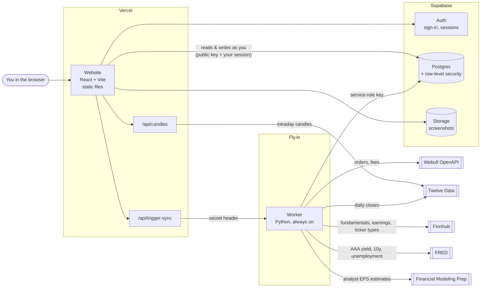
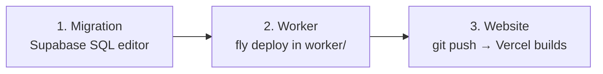

# Application architecture

What the system is made of, where each part runs, how they talk to each other, and how
changes get deployed. Database details are in [DATA_DICTIONARY.md](DATA_DICTIONARY.md);
how data moves is in [DATA_FLOWS.md](DATA_FLOWS.md).

---

## 1. The big picture

**In one sentence:** the website talks straight to the database as you, protected by row-level security. Anything needing a secret (charts data, triggering the worker) goes through a small Vercel function. The always-on worker on Fly.io pulls your Webull trades, the daily prices and the research data (fundamentals and economic numbers) into the database.

---

## 2. Components

| Component | Tech | Runs on | Code | Job |
|---|---|---|---|---|
| Website | React 19, Vite, Tailwind, Recharts, lightweight-charts | Vercel (static) | `web/src/` | Every page you see |
| `/api/candles` | Vercel function (Node) | Vercel | `web/api/candles.ts` | Fetches 1-min / 5-min candles from Twelve Data for trade charts; keeps the API key off the browser |
| `/api/trigger-sync` | Vercel function (Node) | Vercel | `web/api/trigger-sync.ts` | Checks you're signed in, then calls the worker with the shared secret. `?job=prices` triggers pricing instead of a trade sync |
| Database | Postgres + row-level security | Supabase | `supabase/migrations/` | All data |
| Auth | Supabase Auth | Supabase | `web/src/auth/` | Sign-in, password reset, sessions |
| Storage | Supabase Storage (private buckets) | Supabase | `web/src/lib/queries.ts` | Trade screenshots |
| Worker | Python 3, APScheduler, Webull SDK | Fly.io (`trading-journal-worker`, region `iad`, 1 machine always on, volume at `/data`) | `worker/` | Webull sync, fees, daily pricing, research data, HTTP trigger endpoints. The `/data` volume keeps the Webull login token and fee cache across restarts |

> `web/api/_lib/` holds local-dev copies of the two functions (used by `vite.config.ts`).
> Vercel can't bundle local imports into functions, so each deployed function is
> self-contained. Keep the copies in sync when changing either.

### Website pages

| Route | Page | Main tables |
|---|---|---|
| `/` | Today: plan, live risk, today's trades | `trades`, `daily_plans`, `target_settings` |
| `/journal` | Calendar + one card per day | `trades`, `daily_journal`, `daily_plans` |
| `/review` | Review queue + day wrap-up | `trades`, `trade_playbooks`, `daily_journal` |
| `/trades`, `/trades/:id` | Trade log; trade detail with chart | `trades`, `executions`, `options_detail` |
| `/trades/new`, `/trades/:id/edit`, `/trades/import`, `/trades/import/robinhood` | Manual entry, CSV and Robinhood import | `trades`, `executions`, `options_detail` |
| `/insights` | Stats and breakdowns | `trades` (+ review fields) |
| `/wealth` | Wealth overview: net worth, portfolios, month-end close banner | most wealth tables |
| `/portfolios` | All portfolios, Health check, brokerage allocation | `portfolios`, `portfolio_daily_values`, `audit_summary`, `allocation_targets`, `ticker_types`, `fundamentals` |
| `/portfolios/:id` | One portfolio: holdings (with fair value pills), its plan (position targets, add money, plan notes, mix by type), activity, options, puts, dividends and performance | `holdings`, `portfolio_activity`, `csp_positions`, `option_positions`, `dividend_info`, `prices`, `portfolio_daily_values`, `fundamentals`, `position_targets`, `ticker_theses` |
| `/networth` | Net worth by month, accounts, monthly payments | `networth_accounts`, `networth_balances`, `installment_payments`, `wealth_settings` (+ portfolio values) |
| `/cashflow` | What you kept each month, derived from balances | `networth_balances`, `portfolio_activity`, `portfolio_daily_values` |
| `/research` | Fair value, score and next earnings for holdings and a watchlist | `fundamentals`, `macro_indicators`, `research_watchlist`, `research_overrides`, `wealth_settings` |
| `/accounts`, `/settings` | Accounts; risk limits, setups, review checklist | `accounts`, `target_settings`, `playbooks` |

The sidebar has two sides, **Trading** and **Wealth**. They share sign-in but never each other's data: day trades never feed portfolios or net worth.

**Key website modules:**
- **Data access:** `web/src/lib/queries.ts` for the trading journal, `wealthQueries.ts` for net worth and portfolios.
- **Calculations:** trading `metrics.ts`, `insights.ts`, `whatIf.ts`; wealth `portfolio.ts`, `networth.ts`, `cashflow.ts`, `installments.ts`, `dividends.ts`, `research.ts`, `allocationPlan.ts`.
- **Shared app-wide state:** `AuthContext`, `AccountContext` (the trading-account switcher), `ReviewChecklistProvider`.

### Worker files

| File | Does |
|---|---|
| `sync.py` | Entry point. Starts the scheduler and the HTTP server. `--once` runs one sync; `--prices-once` runs pricing; `--research-once` runs research |
| `transform.py` | Webull orders → fills → trades (grouping, P&L) |
| `db_writer.py` | Writes trades via `upsert_trade_bundle`; reads seed fills; writes `sync_log` |
| `fees.py`, `fee_rates.py` | Fee estimate formula; background fetch of real fees |
| `prices.py` | Daily closes from Twelve Data; portfolio daily values |
| `research.py` | Finnhub fundamentals, earnings dates and ticker types; FMP forecast growth; FRED economic series |
| `sync_trigger_server.py` | `POST /sync/trigger`, `POST /prices/trigger`, `GET /healthz` |
| `market_calendar.py`, `rate_limiter.py` | US market holidays; request pacing |

---

## 3. Scheduled and on-demand jobs

| Job | When | What |
|---|---|---|
| Trade sync | Every 15 min, and once on startup. With `SYNC_MARKET_HOURS_ONLY=true` (set on Fly): only 9:00–17:00 New York time on trading days, plus up to 2 syncs in the hour after | Pulls Webull orders → `trades` / `executions`; writes `sync_log` |
| Sync now | Sidebar button (60s cooldown) | Same as above, immediately |
| Daily pricing | 16:45 New York time on trading days | Closes for every held and watchlist ticker → `prices`; each portfolio's value → `portfolio_daily_values` |
| Daily research | Straight after daily pricing | Finnhub data for every held and watchlist ticker → `fundamentals`; FRED series → `macro_indicators` |
| Get prices now | Button on Portfolios / Research when a ticker has no data (2-min cooldown) | Closes and research for new tickers only; no daily value written |

The two trigger endpoints have separate locks and cooldowns, so a trade sync and a price update never block each other.

---

## 4. How requests flow

| You… | Path |
|---|---|
| Open a page | Browser → Supabase directly with the public key + your session token. Row-level security returns only your rows |
| Tag a trade, save a balance | Browser → Supabase `update` / `upsert` on the table |
| Buy, sell, transfer, cash, options | Browser → Supabase **database function** (one all-or-nothing save) |
| View a trade chart | Browser → `/api/candles` → Twelve Data |
| Click Sync now / Get prices now | Browser → `/api/trigger-sync` (checks your session) → worker `POST /sync/trigger` or `/prices/trigger` (checks the secret) → background job. The page then polls the database for the result |
| Upload a screenshot | Browser → Supabase Storage `trade-screenshots/{your id}/…`; shown through 1-hour signed links |

---

## 5. Security model

| Secret / key | Where it lives | Can do |
|---|---|---|
| Supabase **public (anon) key** | Website bundle, so anyone can see it | Nothing on its own. Row-level security limits every app table to the signed-in user's rows |
| Your **session token** | Browser | Read and write your own rows only |
| Supabase **service-role key** | Fly secrets only | Everything, bypassing row-level security. Never in the website |
| `SYNC_TRIGGER_SECRET` | Vercel env + Fly secrets | Start a worker job |
| Webull **app key / secret** | Fly secrets only | Read your Webull orders |
| `TWELVEDATA_API_KEY` | Vercel env + Fly secrets | Market data |
| `FINNHUB_API_KEY` | Fly secrets only | Fundamentals, earnings dates, ticker types |
| `FMP_API_KEY` | Fly secrets only | Analyst EPS estimates (forecast growth) |

**Two users, one database.** Your friend's data is separated by `user_id` + row-level security. The only shared tables are `prices`, `fundamentals` and `macro_indicators`, which hold public market data and are written only by the worker.

**The portfolio ledger is locked.** Signed-in users can read their portfolio tables but can't insert, update or delete holdings, activity, options, puts or cash directly. Every change goes through a database function (`security definer`) that checks ownership and writes the ledger entry. The only direct edits allowed are a portfolio's name, type, archived flag and target %, a holding's manual price, and an option's or put's current price (mark). Activity is append-only: undo marks an entry voided rather than deleting it. Details in [DATA_FLOWS.md](DATA_FLOWS.md#7-rules-that-keep-the-data-consistent).

> **⚠ Known gap:** the five `backup_*_20260711` tables have no row-level security and can
> be read with the public key. See the end of [DATA_DICTIONARY.md](DATA_DICTIONARY.md)
> for the one-line fix.

---

## 6. Configuration

Names only. The values live in each platform's dashboard or secrets store, never in git.

**Vercel (Project → Settings → Environment Variables)**

| Variable | Purpose |
|---|---|
| `VITE_SUPABASE_URL`, `VITE_SUPABASE_ANON_KEY` | Website → Supabase (built into the bundle) |
| `CANDLE_PROVIDER` (`twelvedata`), `TWELVEDATA_API_KEY` | `/api/candles` |
| `WORKER_SYNC_URL`, `SYNC_TRIGGER_SECRET` | `/api/trigger-sync` → worker |

**Fly.io (`fly secrets list` in `worker/`)**

| Variable | Purpose |
|---|---|
| `SUPABASE_URL`, `SUPABASE_SERVICE_ROLE_KEY` | Worker → database (must be the **secret** key, not the publishable one) |
| `WEBULL_APP_KEY`, `WEBULL_APP_SECRET`, `WEBULL_ACCOUNT_ID`, `WEBULL_USER_ID` | Webull sync, and whose trades they are |
| `JOURNAL_ACCOUNT_ID` | Which `accounts` row synced trades belong to |
| `SYNC_TRIGGER_SECRET` | Accepts Sync now / Get prices now |
| `TWELVEDATA_API_KEY` | Daily pricing |
| `FINNHUB_API_KEY` | Daily research (FRED needs no key) |
| `FMP_API_KEY` | Forecast growth for fair value; without it, past growth is used |
| `SYNC_MARKET_HOURS_ONLY` | `true` limits trade syncs to market hours (see section 3) |
| Optional tuning | `SYNC_INTERVAL_MINUTES`, `SYNC_MARKET_START_HOUR` / `_END_HOUR`, `SYNC_AFTER_CLOSE_*`, `SYNC_OVERLAP_DAYS`, `SYNC_TRIGGER_DEBOUNCE_SECONDS`, `PRICES_TRIGGER_DEBOUNCE_SECONDS`, `PRICING_HOUR`, `PRICING_MINUTE`, `WEBULL_*` paging / fee settings |

**Local development:**
- **Website:** `web/.env.local` holds the same variables as Vercel. `npm run dev` serves the two `/api` routes through Vite middleware.
- **Worker:** `worker/.env`.

---

## 7. Deploying changes

There are three independent deploys. **When code depends on a new table or column, run the migration first.**

| Part | How | Notes |
|---|---|---|
| Database | Paste each new file from `supabase/migrations/` into the Supabase SQL editor and run it, in filename order | Applied by hand. Every migration is written to be safe to run twice |
| Worker | `fly deploy` from `worker/` | Check `fly logs` for the startup lines (`listening on :8080…`, `Daily portfolio pricing: 16:45…`) |
| Website | `git push` to `main` | Vercel deploys automatically in about a minute |

**Worker tests:** run `pytest` in `worker/`. The website has no test runner; its checks are `npx tsc -b` (types), `npx oxlint src` (lint) and `npm run build`.

---

## 8. Free-tier limits that shape the design

| Service | Limit | Effect on the design |
|---|---|---|
| Supabase free | 500 MB database, ~5 GB transfer/month | Fine today. Every page loads all your trades (~2.7 KB each), which is why auto-refresh was kept cheap |
| Twelve Data free | 800 lookups/day, 8/min; **no** options, dividends or fundamentals | Prices are batched 8 per minute; option prices and dividends are entered by hand |
| Finnhub free | 60 calls/min; US fundamentals and earnings calendar, no prices history | Calls paced at 1.1 s; 2 calls per ticker (3 the first time, for its name) plus 1 call for the ticker-type list |
| Financial Modeling Prep free | 250 calls/day | 1 call per ticker a day, so up to ~250 researched tickers |
| FRED | Public CSV download, no key | 3 series a day |
| Webull OpenAPI | About 1 request per second for order endpoints | One shared rate limiter for order paging and fee fetching |
| Fly.io | One small always-on machine | Sync and pricing share the process; jobs never overlap themselves |
| Vercel Hobby | Serverless functions, auto-deploy from GitHub | Functions must be self-contained files |

---

## 9. Known limitations

- **Multi-leg Webull orders** (strangles, spreads) are skipped by the sync and logged in `sync_log`. Enter them by hand.
- **`trade_key` doesn't include the account,** so the sync isn't safe for two accounts at the same broker yet. Before adding one, change the unique key to `(user_id, account_id, trade_key)`; see the comment beside `upsert_trade_bundle` in `20260712010000_accounts_multi_broker.sql`.
- **Portfolio prices are daily closes,** not live. Option prices are manual.
- **Fair value needs positive earnings.** Funds (ETFs) and loss-making companies get no fair value or score.
- **Each page loads every trade;** fine at hundreds of trades, worth narrowing at several thousand.
- **Migrations are applied by hand** (there's no migration runner), so the database can drift from the repo if one is skipped. The dictionary's date stamp says when it was last checked against the live database.
