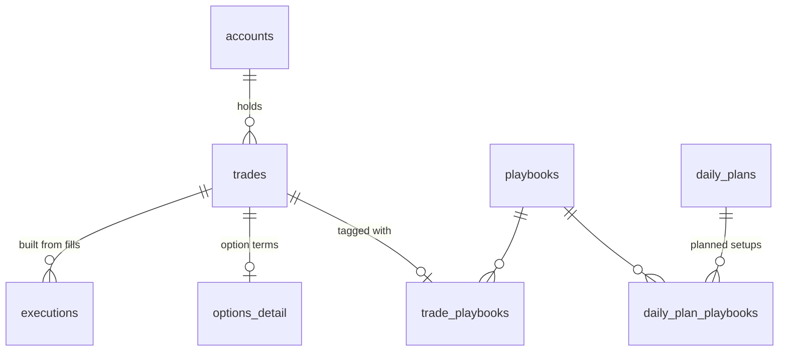
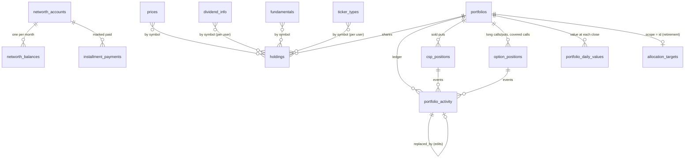
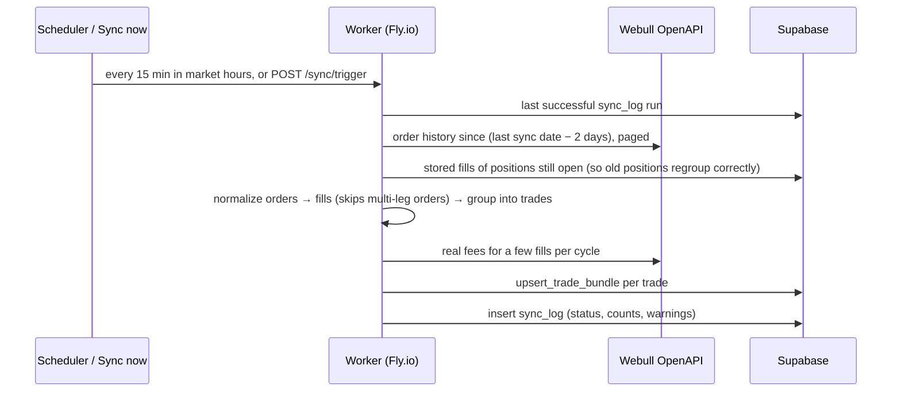
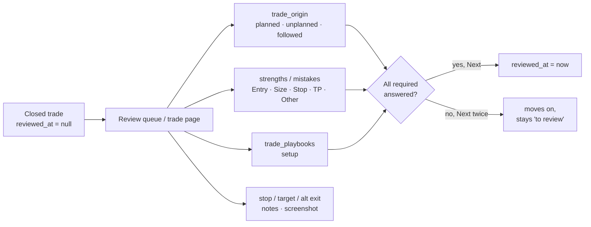
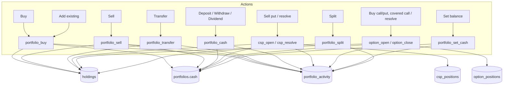
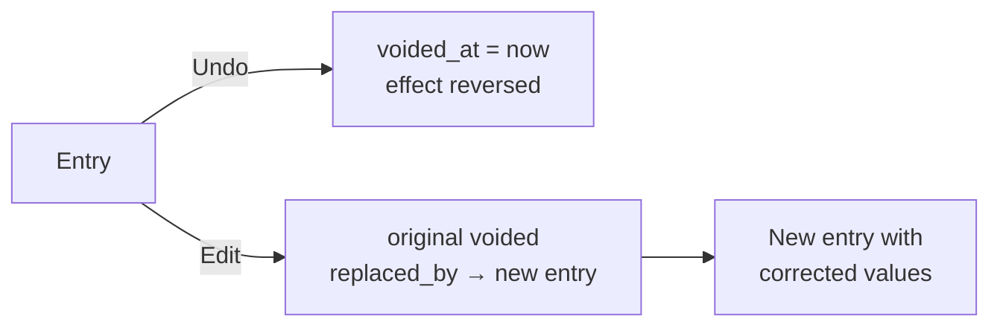
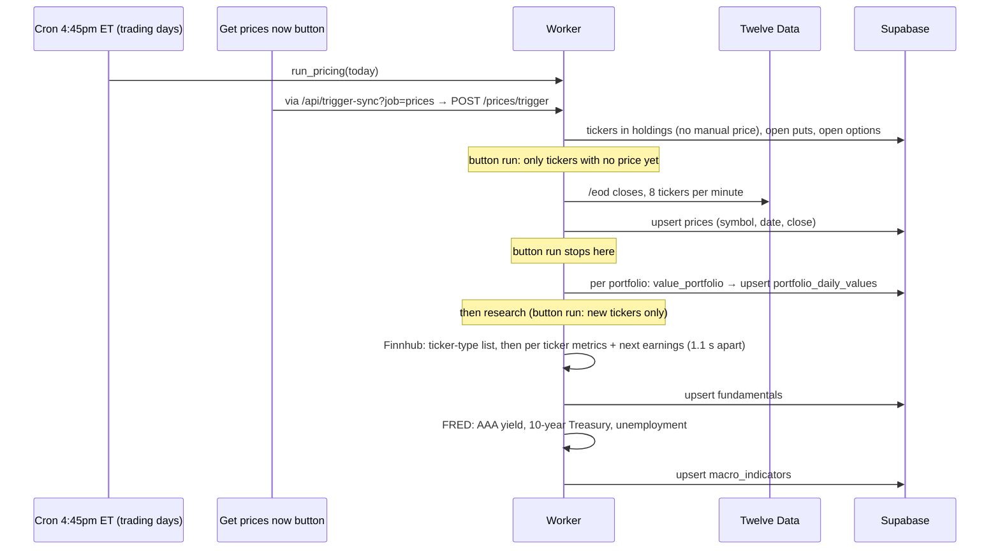
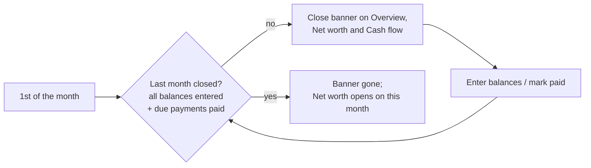

# Data flows

How data gets into the database, how it moves between tables, and how the numbers on
screen are derived from it. Table and column details are in
[DATA_DICTIONARY.md](DATA_DICTIONARY.md); the systems involved are in
[ARCHITECTURE.md](ARCHITECTURE.md).

**Contents**
1. [How the tables relate](#1-how-the-tables-relate)
2. [Trades coming in](#2-trades-coming-in)
3. [Reviewing a trade](#3-reviewing-a-trade)
4. [Portfolio actions](#4-portfolio-actions)
5. [Daily pricing and research](#5-daily-pricing-and-research)
6. [How the numbers are derived](#6-how-the-numbers-are-derived)
7. [Rules that keep the data consistent](#7-rules-that-keep-the-data-consistent)
8. [The month-end close](#8-the-month-end-close)

---

## 1. How the tables relate

### Trading journal



Not linked by keys, but tied by **date** and **user**:
- **`daily_plans` and `daily_journal`** belong to a trading day.
- **A trade's day** is the date of `last_out_at` once closed, or `first_in_at` while open (Central time).
- **`target_settings`** holds one row of per-user settings: limits and the review checklist.
- **`sync_log`** has one row per sync run, per user.

### Wealth (net worth + portfolios)



- **`prices`, `fundamentals`, `dividend_info` and `ticker_types` join to holdings by `symbol`,** not by a key. `prices` and `fundamentals` are shared by all users; the other two are per user.
- **`allocation_targets`** has one `brokerage` row for all brokerage portfolios together, plus one row per retirement portfolio (scope = its id). `portfolios.target_pct` holds the split between brokerage portfolios.
- **`wealth_settings`** holds one row of per-user Wealth settings: close start month, growth cap, economy override, allocation tolerance.
- **Net worth reads portfolios indirectly:** each active portfolio's latest `portfolio_daily_values` row in a month becomes a line under its `kind`.

---

## 2. Trades coming in

Four ways in, and they never collide: each uses its own deduplication key.

| Path | Writes | Dedup key |
|---|---|---|
| Webull sync (automatic) | `trades`, `executions`, `options_detail` via `upsert_trade_bundle`; `sync_log` | `trades.trade_key`, `executions.client_order_id` |
| Manual entry (`/trades/new`) | `trades`, `executions`, `options_detail` | — (`trade_key` null) |
| CSV import | same as manual | — |
| Robinhood CSV import | same as manual | `trades.import_key` |

### Webull sync



Things to know:
- **Grouping:** fills group into one trade per contract, from flat to flat. Re-running produces the same `trade_key`, so re-syncs update rows rather than duplicating them.
- **Fees:** each trade gets an **estimated** fee instantly. **Actual** fees are filled in over later cycles, and `fee_source` flips to `actual`.
- **`manually_closed` trades** keep their outcome (status, exit, P&L, hold time) even when the sync runs again. This is for options that expired worthless, because Webull records no order for an expiry.
- **Multi-leg orders** (e.g. strangles) are skipped and logged as a warning in `sync_log.message`.

---

## 3. Reviewing a trade



- **Every click saves straight away** to `trades` (and to `trade_playbooks` for the setup). The note saves after a short pause.
- **Which labels each section offers** comes from `target_settings.review_checklist`.
- **The trade rows' Entry / Size / Stop / TP checks** are worked out on the fly from `mistakes` and `strengths`; they aren't stored.

---

## 4. Portfolio actions

Every action is a **database function**, so the holding, the cash and the ledger change together or not at all. The page can't edit `cash`, shares or average cost directly: the database refuses it.



**The one idea to understand:** `portfolio_activity.external_flow` separates **money you add or remove** from **what the investments earn**.

| You do | Cash | `external_flow` | Effect on returns |
|---|---|---|---|
| Deposit $1,000 | +1,000 | +1,000 | none: your money, not a gain |
| Buy shares with it | −1,000 | 0 | none: cash became shares |
| Add existing shares | 0 | + their value | none: your money, not a gain |
| Dividend $20 | +20 | 0 | **counts:** earned |
| Sell at a profit | + proceeds | 0 | **counts:** earned |
| Transfer to another portfolio | 0 | − here, + there | none on either side, nets to 0 combined |

That's why "Add existing" and "Deposit" are the right way to bring in things you already owned.

**Set balance** brings cash in line with the broker, including a negative balance for margin used. As a setup or correction it counts as money in or out (no effect on returns). Ticked as interest or fees, it's a real cost and lowers returns.

### Fixing mistakes: edit and undo

Activity is **append-only**. Nothing is ever deleted or changed in place:



- **Undo** (`portfolio_entry_delete`) reverses exactly what the entry did to cash, shares, average cost or option status, then marks it voided.
- **Edit** (`portfolio_entry_edit`, `option_edit`, `csp_edit`) is undo plus the corrected entry, in one save.
- **Order matters for shares:** an entry that changed a holding can only be undone while it's the newest entry for that ticker in that portfolio. Undo newer ones first.
- **Transfers between portfolios** can't be undone; transfer the shares back instead.
- The Activity table hides voided entries; "Show undone or edited entries" brings them back as history.

---

## 5. Daily pricing and research



Tickers priced and researched = everything held (no manual price) + open puts' and options' stocks + the research watchlist.

**How a day's value is calculated** (worker/prices.py `value_portfolio`):

```
holdings_value = Σ quantity × (manual_price, else latest close, else avg cost)
csp_liability  = Σ open puts:   (mark, else max(0, strike − stock)) × 100 × contracts
options_value  = Σ long options: (mark, else price paid) × 100 × contracts
               − Σ covered calls: (mark, else max(0, stock − strike)) × 100 × contracts
total_value    = holdings_value + cash − csp_liability + options_value
net_flow       = Σ external_flow of entries recorded since the previous day's computed_at
               − Σ external_flow of entries undone since then
```

Prices are **closes**, not live: during market hours the latest close is the previous day's.

---

## 6. How the numbers are derived

Nothing below is stored. The website calculates it from the tables each time a page loads.

| Number | Formula | Code |
|---|---|---|
| Net P&L, win rate, profit factor… | From closed `trades.realized_pnl_net` | `web/src/lib/insights.ts` |
| Position size (Pos) | Peak $ committed, walking the fills | `metrics.ts` `computeCostBasisAnalysis` |
| Return % | net P&L ÷ (avg entry × qty × 100 for options) | `metrics.ts` `returnOnCapitalPct` |
| Oversized ⚠ | Pos ≥ 1.5 × median of your last 30 closed trades (same asset type) | `metrics.ts` `typicalPositionSize` |
| R-multiple | gross P&L ÷ (\|entry − stop\| × qty × multiplier) | `whatIf.ts` |
| Portfolio value (live) | Same as the worker's formula, using the latest stored closes | `portfolio.ts` `portfolioSnapshot` |
| Today's change | Σ quantity × (latest close − previous close) | `portfolio.ts` `holdingView` |
| Time-weighted return | Chain each day's (value − net_flow) ÷ previous value | `portfolio.ts` `timeWeightedReturn` |
| Average per year | (1 + TWR)^(365 ÷ days) − 1, shown only after 365 days | same |
| Allocation / weight | Each position ÷ (shares + long options + positive cash) | portfolio pages |
| Dividend income | annual $/share × shares; per payment = ÷ payments per year | `dividends.ts` |
| Dividend calendar | Past months = recorded `dividend` activity; this month on = expected | `dividends.ts` `dividendCalendar` |
| Net worth (month) | Σ assets − Σ debts for accounts open that month (missing month → last earlier balance, "carried") + each portfolio's last daily value in or before that month. Negative portfolio cash becomes a separate **Margin loans** debt | `networth.ts` `monthTotals` |
| Month Net worth opens on | Current month; on the 1st–5th, last month while it isn't closed (section 8) | `cashflow.ts` `netWorthOpenMonth` |
| Cash flow: what you kept | Cash saved (change in cash + emergency fund) + invested (deposits − withdrawals) + debt paid down. Investment growth and other changes reconcile it to the net worth change | `cashflow.ts` `monthCashFlow` |
| Payment due | Fixed payment: that amount, on its day that month. Card with only a due day: that month's closing balance, due on its day **next** month | `installments.ts` `expectedPayment`, `paymentDueDate` |
| Payoff estimate | Months n = −ln(1 − r·B/P) ÷ ln(1 + r), r = APR ÷ 12, P = payment − escrow | `installments.ts` `payoff` |
| Fair value | EPS × (7 + g) × 4.4 ÷ AAA yield. g = lower of 5-year and 3-year EPS growth, floored at 0, capped (default 30). "Buy below" = 85% of fair value | `research.ts` `fairValue` |
| Score (out of 100) | Valuation 20 (price ÷ fair value) + Growth 20 + Moat 20 (gross margin + return on equity) + Execution 10 (profitable, debt, current ratio) + Economy 30 (less for rising unemployment and a high 10-year yield). 80+ Strong, 70–79 Good, 60–69 Fair, under 60 Weak. Overrides replace any part | `research.ts` `research` |
| Ticker type | Your `ticker_types` choice; else Finnhub type: ETP / closed-end fund → ETF (bond if its name says bond, treasury or T-bill), everything else → stock; else built-in lists | `allocationPlan.ts` `classify` |
| Allocation mix | Holdings by type + long options + positive cash, per pool (brokerage portfolios together; each retirement account alone). Margin and sold options are left out | `allocationPlan.ts` `mixOf` |
| On / over / under target | Actual % − target %, within ± tolerance = on target. Add / trim $ = (target % − actual %) × pool total | `allocationPlan.ts` `compareToTargets` |

---

## 7. Rules that keep the data consistent

| Rule | Enforced by |
|---|---|
| Each user only sees their own rows | RLS on every app table |
| A synced trade isn't duplicated on re-sync | `unique (user_id, trade_key)` + `upsert_trade_bundle` |
| A Robinhood re-import is a no-op | `unique (user_id, account_id, import_key)` |
| A manually closed trade stays closed | `manually_closed` checked inside `upsert_trade_bundle` |
| One setup per trade | `trade_playbooks` primary key on `trade_id` |
| One balance per account per month | `unique (account_id, month)` |
| One holding row per ticker per portfolio | `unique (portfolio_id, symbol)` |
| Can't sell more shares than held | `portfolio_sell` / `portfolio_transfer` |
| Can't sell or move shares covering open calls | `_covered_shares` check in sell / transfer / covered call |
| Each covered call needs 100 uncovered shares | `option_open` |
| Cash moves only with a ledger row | all portfolio functions; direct writes revoked from signed-in users |
| Activity is never changed or deleted, only voided or replaced | `portfolio_activity_append_only` trigger |
| Shares and average cost come only from Activity | holdings writes revoked; `audit_summary` flags any drift |
| A mix target adds up to 100% | check on `allocation_targets` |
| One closing price per ticker per day | `prices` primary key `(symbol, price_date)` |
| One value per portfolio per day | `portfolio_daily_values` primary key `(portfolio_id, value_date)` |

---

## 8. The month-end close

Net worth runs on **month-end balances**, so each month has to be closed: every open account gets its balance as of the last day, and every due payment is marked paid.



- **Which month Net worth opens on:** the current month from the 6th onward. On the 1st–5th it stays on last month until that month is closed, and the banner says so. After the 5th, an unclosed month keeps its banner with an **Open** button.
- **Where closing starts:** months before `wealth_settings.close_from_month` are never asked to be closed ("Start from this month" on the banner).
- **Balances carried forward:** a month with no balance entered uses the last earlier one, marked "carried", so totals never drop to zero. Cash flow marks a month incomplete while it leans on carried balances.
- Code: `cashflow.ts` `closeStatus`, `CloseMonthBanner.tsx`.
